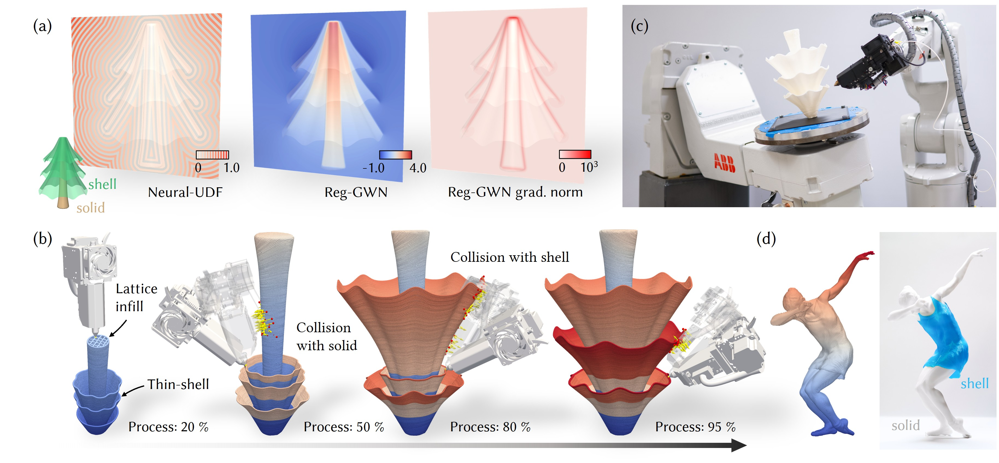
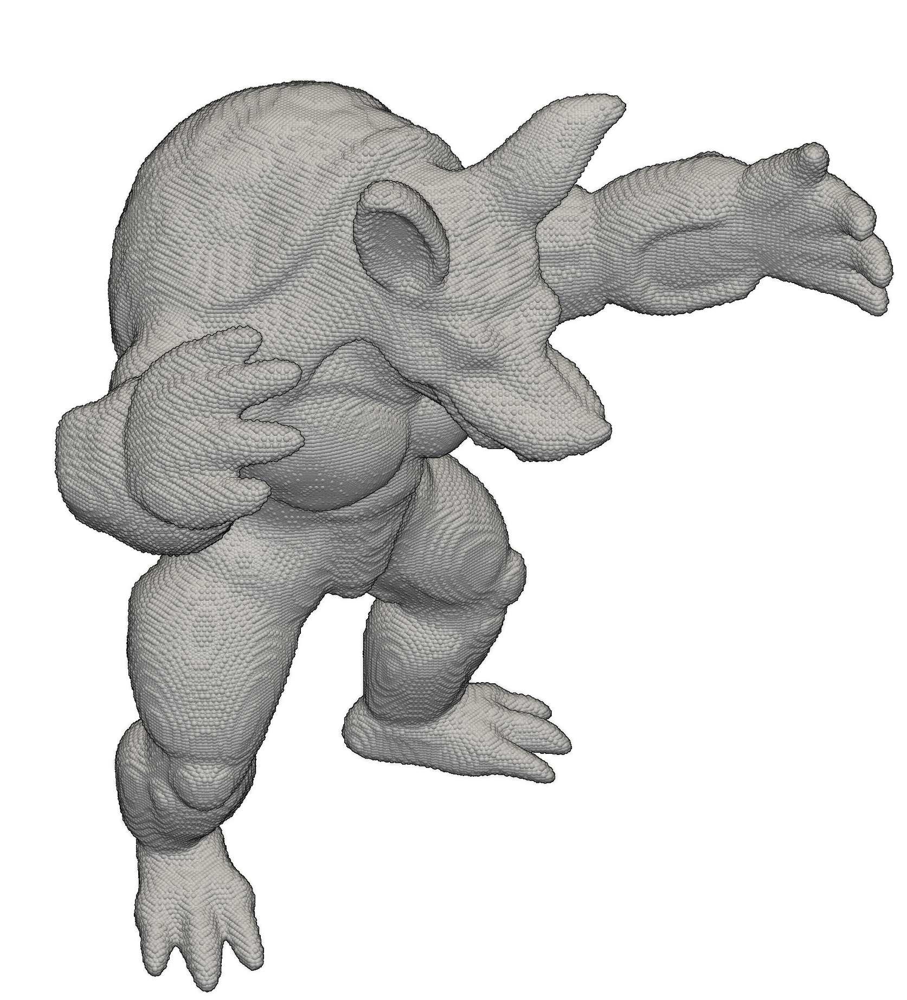
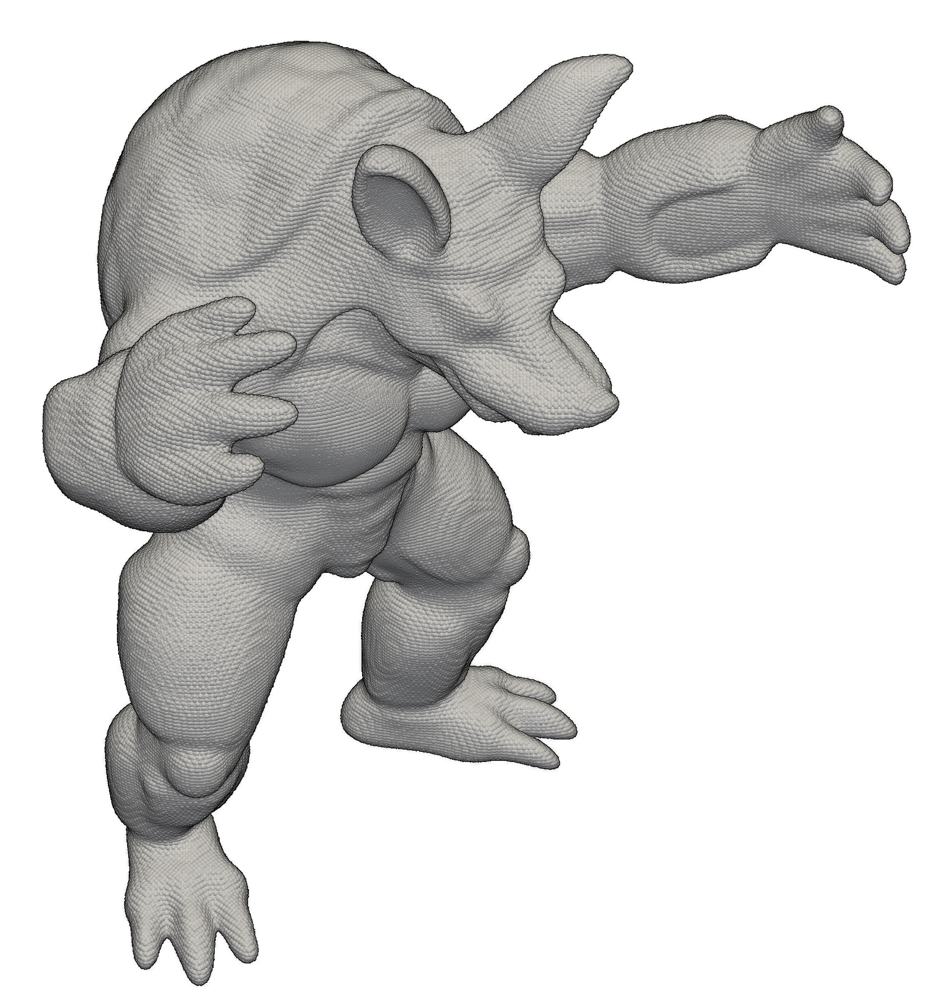
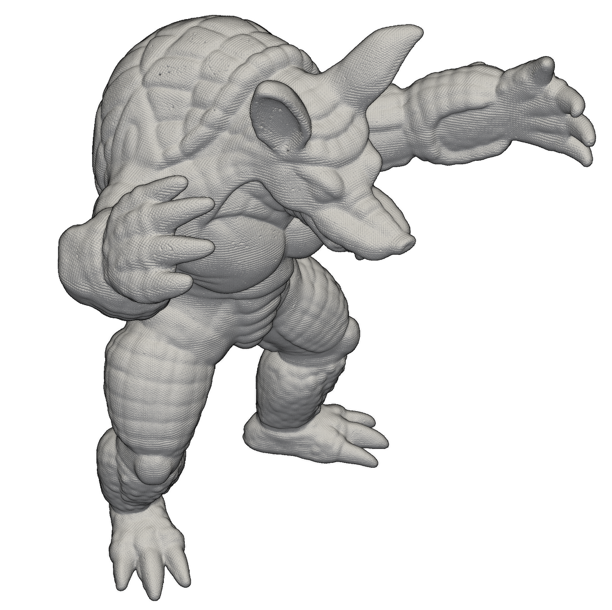
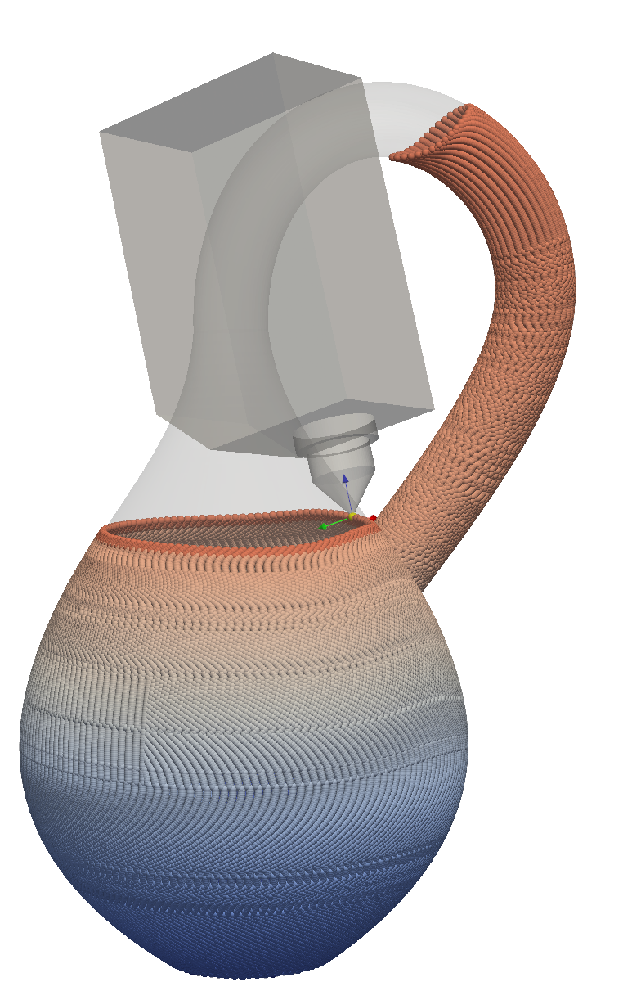
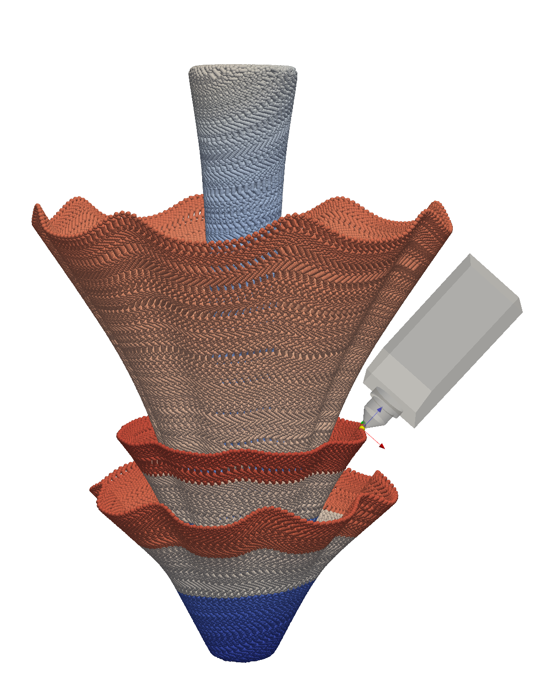
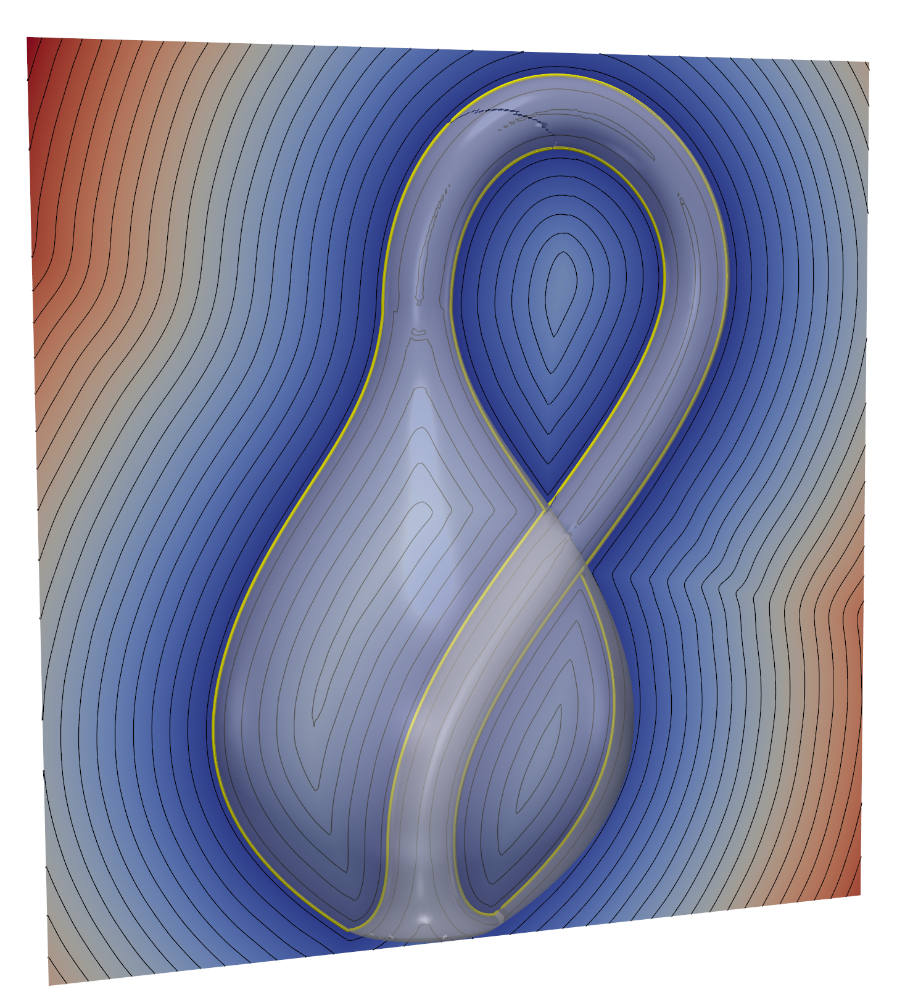
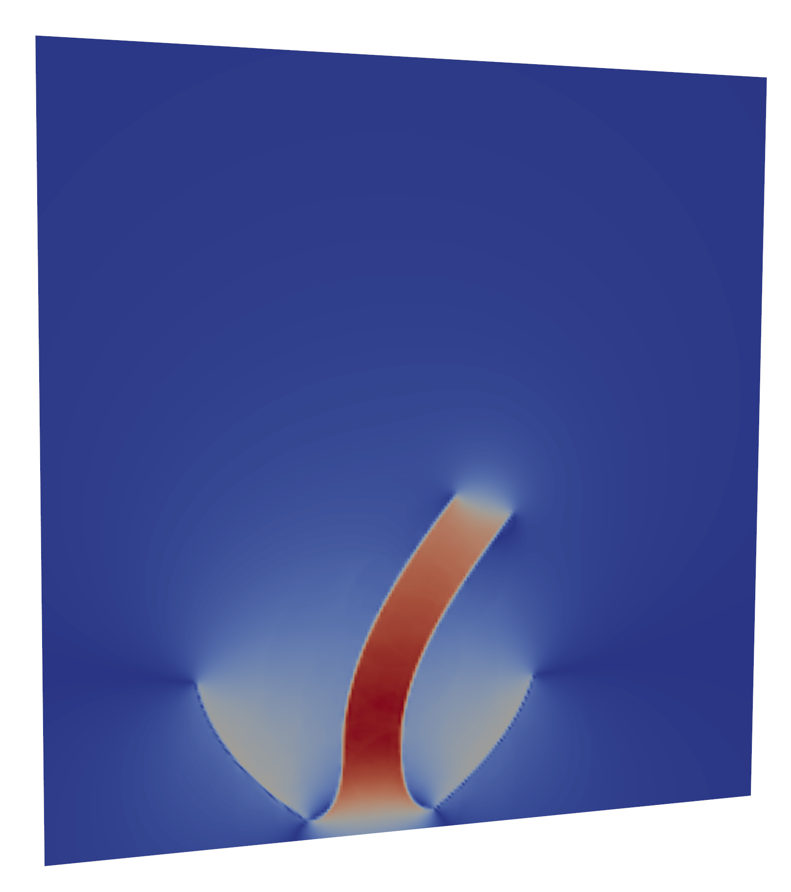
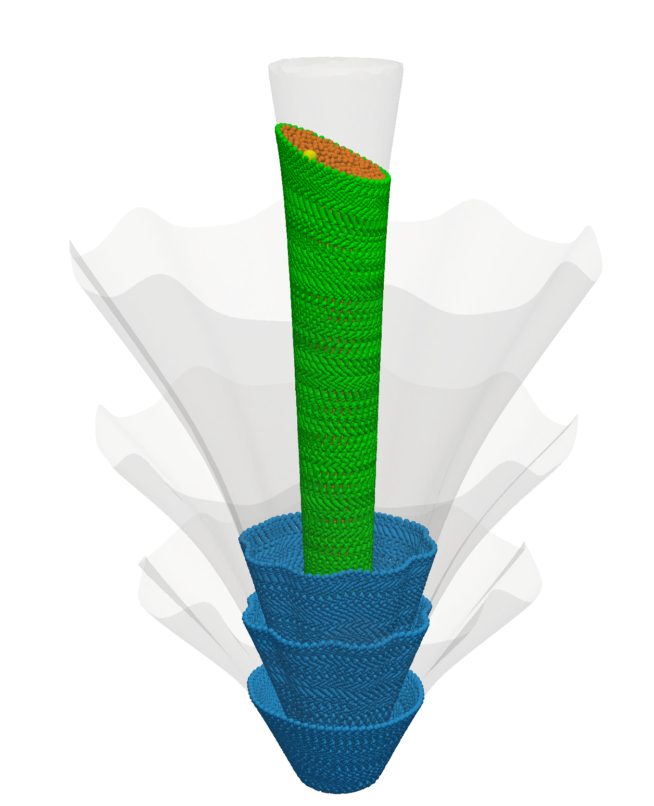

# WildFab: Multi-Axis 3D Printing from Models in the Wild


<p align="center">
  <a href="https://qjiasheng.github.io/crml/wildfab/">
    
  </a>
  <a href="https://arxiv.org/abs/2609.02413">
    
  </a>
  <a href="https://youtu.be/mfFn-gAqRtk">
    
  </a>
  <a href="https://www.bilibili.com/video/BV1TWtv6QESe">
    
  </a>


> SIGGRAPH Asia 2026 (ACM Transactions on Graphics)
>
> [Jiasheng Qu<sup>1</sup> ](https://qjiasheng.github.io/), Zhikai Shen<sup>1</sup>, Chenyu Xu<sup>1</sup>, Hailin Sun<sup>1</sup>, [Chengkai Dai<sup>3</sup>](https://chengkai-dai.github.io/), Yuhu Guo<sup>3</sup>, [Junpeng Wang<sup>4</sup>](https://psler.github.io), Yeung Yam<sup>1,2</sup>, and [Guoxin Fang<sup>1, 2, *</sup>](https://guoxinfang.github.io/) 
>
> 1 The Chinese University of Hong Kong, China. 2 Centre for Perceptual and Interactive Intelligence, Hong Kong, China.
3 Carnegie Mellon University, USA. 4 Technical University of Denmark, Denmark.

# Overview
WildFab proposes a new hybrid query field representation (Neural-UDF + Reg-GWN) to slice models in the wild and enable collision-free motion planning.

☁️ With the proposed computational pipeline, WildFab even supports oriented point clouds as input.



# Guidance 
Read this 👇🏻 before starting 

+ 👋 Check the similar repo [INF-3DP](https://github.com/Qjiasheng/INF-3DP); 
+ 👋🏻 My previous run logs are available on [Google Drive](https://drive.google.com/drive/folders/1X2Nsz4LVISGAt-QcBHsO8l8oCIFtrEv_?usp=sharing); download them and run `test_**.py` if you want to quickly check the results;
+ 👋🏽 Please refer to [INF-3DP](https://github.com/Qjiasheng/INF-3DP) for graph-based printing sequence planning.

## Installation
Installation is similar to that of [INF-3DP](https://github.com/Qjiasheng/INF-3DP), which offers detailed steps.

### Python environment
Use Python 3.10–3.12, we use CUDA 12.1

```bash
git clone https://github.com/Qjiasheng/WildFab.git
cd WildFab

conda create --name wildfab python=3.10
conda activate wildfab

pip install poetry
poetry install
```

### CUDA modules

See [submodules/readme.md](submodules/readme.md) for prerequisites and each module's functionality.

```bash
python -m pip install --no-build-isolation \
    ./submodules/octree_fwn \
    ./submodules/octree_nt_fwn \
    ./submodules/contour_cuda \
    ./submodules/contour_connect \
    ./submodules/simple_dists
```


## Usage
> Almost all results can be visualized directly in a pop-up window or by loading saved data in the `viewers`. 

Throughout the project, the basic commands for training and testing are:
```bash
# Replace the placeholders with the corresponding training or testing script, experiment name, and config file.
python exp_scripts/train_XXX.py --experiment_name=XXX --config_path=configs/XXX_config.yaml 

python exp_scripts/test_XXX.py --experiment_name=XXX --config_path=configs/XXX_config.yaml 
```

👀 Neural-UDF, Reg-GWN, and time-varying Reg-GWN can be used independently of the rest of the project.
There are `toy_tests` for Reg-GWN and TV-Reg-GWN.

## Test your models
> For new test models, set the experiment configurations in the corresponding config files.
+ Meshes (the default is `.obj`). 
+ Point clouds (the default is `.xyz` containing [coords, normals]).
+ Other geometries (B-Rep, voxels ...) can be sampled into clouds for using.

Put the model file under `udf_data/models_data` and set the corresponding configurations in `data_config.yaml`. Run:
```bash
python udf_data/pre_data.py --model=fertility_pcd
```
This will prepare data for further field training using the specified configurations, e.g., UDF training in `configs/udf_config.yaml`.


## Key parts
Neural-UDF + Reg-GWN

+ Recovering surface details and tracing toolpaths.
<table width="100%">
  <tr>
    <td align="center" valign="top" width="33%">
      
      <br>
      <b>Tracing the minimum UDF level</b>
    </td>
    <td align="center" valign="top" width="33%">
      
      <br>
      <b>Tracing the minimum UDF gradient norm</b>
    </td>
    <td align="center" valign="top" width="33%">
      
      <br>
      <b>Tracing the maximum Reg-GWN gradient norm</b>
    </td>
  </tr>
</table>

+ Collision evaluation and optimization. 
> ⚠️ Please refer to [INF-3DP](https://github.com/Qjiasheng/INF-3DP) for graph-based printing sequence planning. Users can plan the printing sequence from the sliced results and prepare waypoint files, then run collision optimization. Download our log data for a quick check in the viewers. 
 <table width="100%">
  <tr>
    <td align="center" valign="top" width="50%">
      
      <br>
    </td>
    <td align="center" valign="top" width="50%">
      
      <br>
    </td>
  </tr>
</table>


### Viewers
We provide viewers to check (1) field volume data; (2) waypoints; and (3) collision results. Use our log data for a quick check.
<table width="100%">
  <tr>
    <td align="center" valign="top" width="33%">
      
      <br>
      <b>Neural-UDF</b>
    </td>
    <td align="center" valign="top" width="33%">
      
      <br>
      <b>Time-varying Reg-GWN</b>
    </td>
    <td align="center" valign="top" width="33%">
      
      <br>
      <b>Waypoints of different types</b>
    </td>
  </tr>
</table>


### BibTeX
```bibtex
@article{Qu2026wildfab,
      title={WildFab: Multi-Axis 3D Printing from Models in the Wild},
      author={Qu, Jiasheng and Shen, Zhikai and Xu, Chenyu and Sun, Hailin and Dai, Chengkai and Guo, Yuhu and Wang, Junpeng and Yam, Yeung and Fang, Guoxin},
      journal={ACM Transactions on Graphics (TOG)},
      pages={1--19},
      year={2026},
      publisher={ACM}
      }
```

### Acknowledgements
This code has been greatly improved with the help of Codex and is based on [SIREN](https://github.com/vsitzmann/siren) and our previous work, [INF-3DP](https://github.com/Qjiasheng/INF-3DP).

Contact: Jiasheng QU (jsqu@mae.cuhk.edu.hk)
